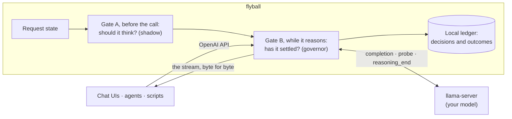
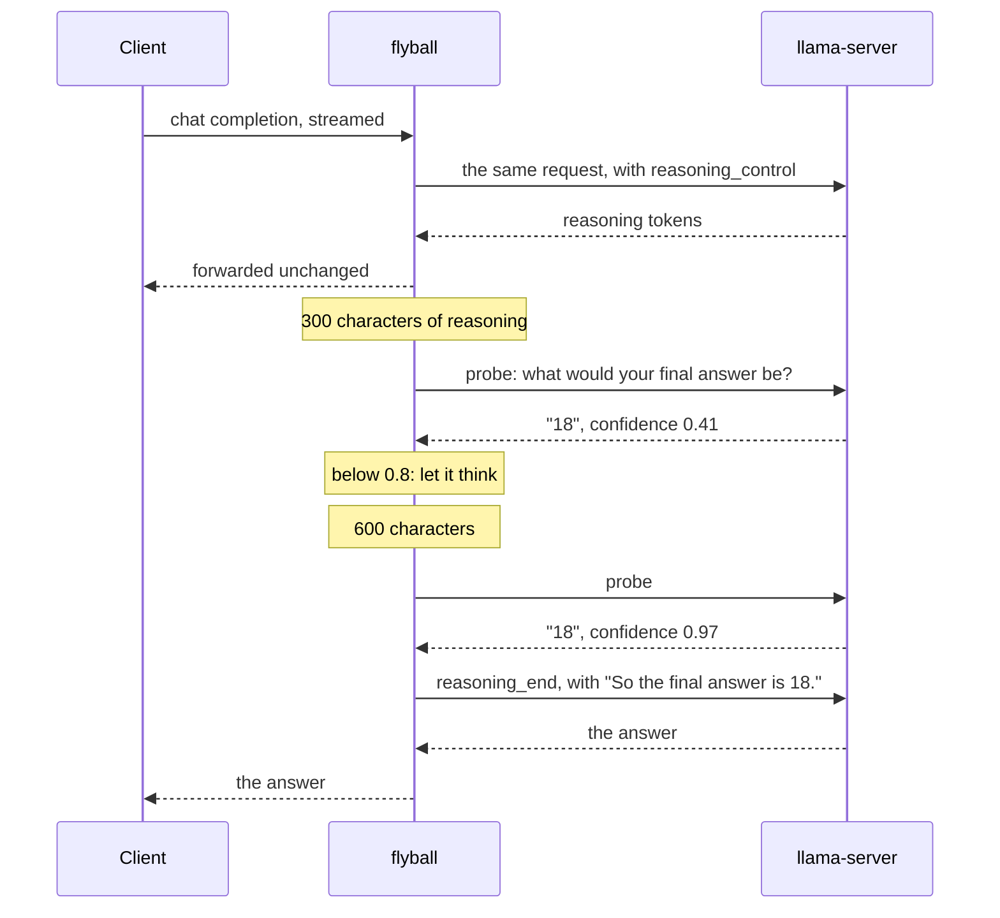

<div align="center">

# flyball

**A governor for your local model's reasoning.**

It sits in front of your local model and stops its reasoning once the model has settled on
its answer, so you wait less for the same answers.

[](LICENSE)


</div>

---

Reasoning models think before they answer, and they often keep thinking long after the
answer is already there. On a local GPU every one of those tokens is seconds of your time.
flyball is an OpenAI-compatible proxy that watches the reasoning as it streams, asks the
model, every so often, what its final answer would be and how sure it is, and closes the
reasoning as soon as the model is confident. Every client you already use (a chat UI, an
agent, a script) gets the benefit at once, without changing anything.

> [!IMPORTANT]
> flyball is a **research preview**. The results below come from one model on one GPU,
> measured on a few hundred problems. The governor needs a small addition to llama.cpp
> (the `probe` control action) that is not upstream yet. The standard benchmarks are run
> in full before any release.

## Contents

- [The problem](#the-problem)
- [How it works](#how-it-works)
- [Results](#results)
- [Quick start](#quick-start)
- [Configuration](#configuration)
- [Design rules](#design-rules)
- [Reproducing the research](#reproducing-the-research)
- [Roadmap](#roadmap)
- [Why "flyball"](#why-flyball)

## The problem

Measured on Ternary Bonsai 2 27B, running entirely in the VRAM of an RTX 3080 at about 80
tokens a second, at its highest reasoning effort:

- **The answer comes early, the reasoning goes on.** Asked mid-reasoning, the model already
  gives the right answer at two checkpoints in three, and at nearly half of them it is more
  than 90% sure of it.
- **Sometimes the reasoning never ends.** One reasoning in five on MBPP, and one in four on
  MMLU-Pro, ran into the 8,192-token limit without answering. On MBPP they were not loops:
  the model has its solution and keeps checking stranger and stranger cases.
- **So thinking less can be better.** On MMLU-Pro, never stopping the reasoning answered
  60.0% correctly in 53.7 seconds on average; stopping it answered 68 to 71% correctly in 6
  to 11 seconds.

llama.cpp already offers a fixed budget, `--reasoning-budget`, and it helps. But it is
blind: the same cut for every question, too late for the easy ones and too early for the
hard ones, where the model then carries its interrupted thinking into the answer.

## How it works



flyball forwards every request and response untouched. Around that, it asks two questions:

**Gate A, before the call: does this request need to think, and how much?** Today a
heuristic answers it in shadow mode, recording what it would decide without acting. A
learned backend is on the [roadmap](#roadmap).

**Gate B, while the model reasons: has it settled on its answer?** This is the governor,
and it is what the research so far has been about.



- **The probe.** Once the reasoning passes 300 characters, and each time it doubles, flyball
  asks the server to probe the live completion: close the reasoning on a copy of its state,
  start the reply with a final-answer box, and decode the few tokens of the answer, reading
  their real probabilities. The copy is then thrown away. Generations with and without
  probes are identical byte for byte, and a probe costs about 0.2 seconds.
- **The decision.** When the model is at least 0.8 confident in an answer that is a number
  or an option letter, flyball ends the reasoning. If that never happens, it ends it at
  3,200 characters anyway.
- **The anchor.** The reasoning is closed with one forced sentence, "So the final answer is
  X.", so the reply builds on that answer instead of picking the reasoning back up.
- **The scope.** Only what was measured is governed: streamed questions that ask for a
  number or list options, without tools, images or code. Everything else passes through.

Why ask the model rather than read its reasoning with a small classifier? Because that was
tried first, and it lost to a fixed budget: the words of the reasoning do not say when it
is done. The model's own confidence does, and it is well calibrated:

| the model's confidence in its answer | checkpoints | the answer was right |
|---|---|---|
| below 0.30 | 865 | 14% |
| 0.30 to 0.70 | 392 | 55% |
| 0.70 to 0.90 | 370 | 80% |
| 0.90 to 0.97 | 374 | 91% |
| 0.97 and above | 1,129 | 97% |

## Results

All live, with real cuts, on problems never used to choose the settings, Bonsai 2 27B at
its highest reasoning effort and usual sampling. Each problem is answered by every arm, in
an order that rotates from problem to problem. The fixed budget closes the reasoning at
2,400 characters, the best fixed setting found on other problems.

**Maths: MATH levels 3 to 5 and GSM8K, 127 problems**

| | accuracy | mean time | time saved per request | time saved in total |
|---|---|---|---|---|
| never cut | 92.1% | 14.4 s | | |
| fixed budget | 94.5% | 10.1 s | 4% | 30% |
| governor | **95.3%** | **8.9 s** | **9%** | **38%** |

Against the fixed budget, the governor saves 4 to 13 more points of time per request (95%
confidence, two passes), at an accuracy the intervals cannot tell apart. Ending each cut
with the anchor sentence then cut total time by another fifth (7.0 s against 9.0 s), and no
reply after a cut ran away any more.

**Multiple choice: MMLU-Pro, 75 questions across fourteen subjects**

| | accuracy | mean time |
|---|---|---|
| never cut | 60.0% | 53.7 s |
| fixed budget | 70.7% | 10.9 s |
| governor | 68.0% | **6.5 s** |

The governor is faster than the budget by 14 to 59% of total time, at an accuracy 8.0
points lower to 2.7 points higher.

**Code: MBPP, 150 problems.** Code has no short answer to ask for, so the probe asks the
model whether its solution is settled. That signal is calibrated too (its code passes 54%
of the time below 0.7, and 96% above 0.85), but MBPP does not need it: code written after
200 characters of reasoning already passes more often than code written after all of it.
flyball does not govern code requests until the probe has been measured on code that needs
its reasoning.

**What the numbers do not say yet.** All of this runs at the highest reasoning effort,
where the model overthinks most; at a server's default effort the gains are smaller and are
being measured. One model, one GPU, samples of 75 to 150 problems, intervals that are still
wide. The full account, including every negative result and the measurement bugs found on
the way, is in **[docs/gate-b-research.md](docs/gate-b-research.md)**.

## Quick start

**Requirements:** Python 3.10 or newer, and an OpenAI-compatible server.
[llama.cpp](https://github.com/ggml-org/llama.cpp) gets everything; other servers (vLLM,
SGLang, Ollama, LM Studio, mlx-lm) get Gate A, which needs no mid-stream control. flyball
needs nothing else in `off` and `shadow` mode; the governor also needs the server's
`probe` control action.

```bash
git clone https://github.com/Siphion/flyball && cd flyball
pip install -e .

# What can this server do?
flyballd probe --upstream http://127.0.0.1:8081

# Watch and record, change nothing
flyballd serve --upstream http://127.0.0.1:8081 --port 8080 --mode shadow

# Govern the reasoning (needs the probe action)
flyballd serve --upstream http://127.0.0.1:8081 --port 8080 --mode active --governor

# What happened so far
flyballd stats
```

Then point your clients at `http://127.0.0.1:8080/v1` instead of the server: same API,
same model name, same key.

### Modes

| mode | what flyball does |
|---|---|
| `off` (default) | forwards everything, records nothing |
| `shadow` | decides and records what it would do, changes nothing |
| `active` | applies the decisions that passed their measurements; the governor only with `--governor` |

More in [docs/modes.md](docs/modes.md).

## Configuration

Everything is read from the environment, and the main settings also have command-line
flags. See [.env.example](.env.example).

| variable | default | meaning |
|---|---|---|
| `FLYBALL_UPSTREAM` | `http://127.0.0.1:8081` | the server that runs the model |
| `FLYBALL_HOST`, `FLYBALL_PORT` | `127.0.0.1`, `8080` | where flyball listens |
| `FLYBALL_API_KEY` | | key clients must present; empty means none |
| `FLYBALL_UPSTREAM_API_KEY` | | key sent to the server |
| `FLYBALL_MODE` | `off` | `off`, `shadow` or `active` |
| `FLYBALL_DATA_DIR` | `./data` | where the ledger is written |
| `FLYBALL_AB_SHARE` | `0.5` | share of conversations that get the decisions; the rest are the control arm |
| `FLYBALL_SERVER` | `auto` | `auto`, `llama.cpp`, or `openai` for any other OpenAI-compatible server |
| `FLYBALL_PROFILE`, `FLYBALL_PROFILES` | | force a model profile; load extra or changed ones from JSON |
| `FLYBALL_DEFAULT_LEVEL` | | the reasoning level of requests that name none, if the server sets its own |
| `FLYBALL_GATE_A` | `off` | `on` lets a learned System 1 pick each request's reasoning level |
| `FLYBALL_GATE_A_ARTIFACT` | | the Gate A model; empty means the one in the model's profile |
| `FLYBALL_GOVERNOR` | `off` | `on` enables the governor in active mode |
| `FLYBALL_GOVERNOR_*` | profile | override the profile's operating point: `CONFIDENCE`, `CAP`, `FIRST_PROBE`, `GROWTH`, `ANCHOR` |

The full list, with the Gate A settings, is in [docs/modes.md](docs/modes.md#settings).

## Design rules

1. **Fail open.** flyball sits in the critical path. Any error inside it, a refused probe, an
   unreachable control endpoint, and the request is served as if flyball were not there.
2. **Responses are never rewritten.** The client receives the server's stream byte for byte.
   The only change to a governed request is `reasoning_control: true`, which lets its
   reasoning be ended.
3. **Measure, then act.** Nothing acts on live traffic before it has been measured against a
   simpler baseline, and only on the kind of request it was measured on. In active mode a
   share of conversations stays in a control arm, so the effect keeps being measured.
4. **A kill switch.** Create a file named `KILL` in the data directory and every decision
   stops at once, without a restart.
5. **Your prompts stay with you.** The ledger is local, keeps a short excerpt of each request
   with secrets redacted, and is excluded from git. With `FLYBALL_API_KEY` set, clients must
   present it, and the server's own key never leaves flyball.

## Reproducing the research

Every number above comes from scripts in [`tools/`](tools), run against a live server.

| step | script |
|---|---|
| build problem sets | `build_gsm8k_cases.py`, `build_math_cases.py`, `build_mmlu_pro_cases.py`, `build_mbpp_cases.py` |
| record uncut reasoning traces | `measure_reasoning_cut.py --cuts 0 --traces ...` |
| label checkpoints with the teacher | `probe_traces.py` (`--protocol trial`, `free` or `code`) |
| compare governors offline, choose a probe schedule | `compare_governors.py`, `train_gate_b.py` |
| run problems at every reasoning level, and the ceiling of choosing per problem | `effort_sweep.py`, `effort_ceiling.py` |
| train and evaluate a System 1 for Gate A | `embed_texts.py`, `gate_a_eval.py` |
| read the model's hidden states at labelled checkpoints | `extract_hidden.py`, `system1_representation.py --features` |
| measure the probe live | `probe_live.py` |
| run the governor live against a budget | `govern_live.py` |
| run generated code, isolated | `sandbox.py` (Docker, no network) |

MATH problems come from the training split of OpenAI's PRM800K, so MATH-500 stays clean;
MBPP problems from MBPP's training split, so MBPP+ stays clean.

## Roadmap

- [x] Transparent proxy, shadow ledger, capability probe
- [x] The governor: self-probing, calibrated cut, cap, anchor; live on maths and multiple choice
- [x] Not tied to one stack: server adapters, model profiles with per-level operating points, swappable System 1s
- [ ] Results at the default reasoning effort, with a probe schedule chosen there
- [ ] Gate A with a learned backend: choosing, before the call, how much to think (code done, measurements pending)
- [ ] A probe for code that needs its reasoning, and for open-ended answers
- [ ] Reading the model's hidden state instead of asking it: no probe pauses, a signal at every token (offline tools done)
- [ ] Mid-stream control on other servers: abort and continue with the reasoning as a prefix
- [ ] Other local models, with calibrations shared per model
- [ ] The probe action proposed to llama.cpp, so the governor works on a stock server
- [ ] The standard benchmarks in full: MATH-500, GSM8K, AIME, GPQA Diamond, LiveCodeBench, HumanEval+ and MBPP+

## Why "flyball"

The flyball governor is the spinning pair of weights James Watt put on steam engines: two
small masses, flung outwards by the speed of the engine, that throttle the steam when it
runs too fast. A small mechanism regulating a large one, without anyone at the controls.
That is the idea.

## License

[Apache 2.0](LICENSE).
